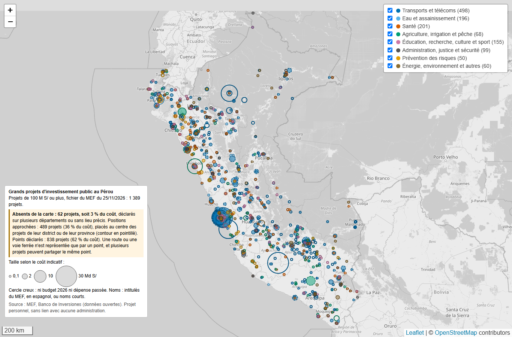

# Pipeline de los grandes proyectos de inversión pública en el Perú

[Version française](README.md)

Proyecto personal de Stanislas Sassolas (estudiante de ingeniería, CPE Lyon), sin vínculo con ninguna institución.

[](https://stanislas-sassolas.github.io/pipeline-inversiones-peru/carte.html)

[Ver la página del proyecto, con el mapa interactivo](https://stanislas-sassolas.github.io/pipeline-inversiones-peru/es.html)

El Ministerio de Economía y Finanzas del Perú (MEF) publica cada día, en datos abiertos, la lista de todas sus inversiones públicas activas: el Banco de Inversiones (unas 150 000 inversiones, un CSV de 250 MB). Este pipeline de datos en Python archiva las versiones sucesivas del archivo, calcula indicadores sobre los grandes proyectos (S/ 100 millones o más), detecta lo que cambia de una semana a otra, sigue las convocatorias de ProInversión y genera una nota de tres páginas y un mapa interactivo. Al 25/11/2026: 1 389 grandes proyectos y S/ 726 500 millones de costo indicativo. Python, pandas, folium, 153 pruebas automáticas.

El código, sus comentarios, la nota, la ficha, el mapa y la documentación de método ([METHODE.md](METHODE.md)) están en francés.

## En resumen

| Salida | Archivo | Script |
|---|---|---|
| Archivo fechado del Banco de Inversiones | `<datos>/snapshots/inversiones_<fecha>.parquet` | `archiver.py` |
| Indicadores (archivo de trabajo) | `exports/indicateurs_<fecha>.xlsx` | `indicateurs.py` |
| Lo que cambió (archivo de trabajo) | `exports/changements_<fecha1>_<fecha2>.xlsx` | `changements.py` |
| Convocatorias de ProInversión (archivo de trabajo) | `exports/proinversion_<fecha>.xlsx` | `proinversion.py` |
| Nota de tres páginas (lectura rápida) | `exports/note_<fecha>.pdf` | `note.py` |
| Ficha de dos páginas (todos los indicadores) | `exports/fiche_<fecha>.pdf` | `fiche.py` |
| Mapa interactivo | `exports/carte_<fecha>.html` | `carte.py` |
| Página de demostración, en francés y en español | `docs/index.html`, `docs/es.html` (GitHub Pages) | `pipeline.py --publier` |

Los archivos « de trabajo » detallan proyecto por proyecto. La ficha y el mapa no citan ninguna empresa fuera de los nombres oficiales del MEF y no clasifican ninguna región.

Las reglas de cálculo y los límites de cada etapa se detallan en [METHODE.md](METHODE.md).

## Instalación y ejecución

Python 3.11 y Google Chrome, y luego:

```
python -m pip install -r requirements.txt
python -m pytest                               # las pruebas, sin internet ni datos: pequeñas tablas inventadas
python pipeline.py                             # todas las etapas, en orden
python pipeline.py --sans-archivage            # sin descargar el archivo del MEF
python pipeline.py --sans-archivage --publier  # y después actualización de docs/
```

El pipeline necesita al menos dos archivos de días distintos: el primer día, ejecutar solo `python archiver.py`, y `python pipeline.py` al día siguiente. También necesita internet: el MEF (archivo, unos 250 MB), el BCRP (tipo de cambio, guardado después en caché), investinperu.pe (una vez al día) y, para la captura del mapa, Leaflet y los mosaicos de OpenStreetMap. Chrome se encuentra solo en Windows y Linux; si no, indicar su ruta en la variable de entorno `CHROME`. Los archivos se guardan fuera del repositorio, en `~/data/inversiones-peru` (variable `INVERSIONES_DATA`).

Las pruebas también se ejecutan automáticamente en GitHub en cada envío (`.github/workflows/tests.yml`).

Archivos hechos a mano, con su fuente cuando se trata de una corrección: `secteurs.csv` (agrupación de las funciones en sectores), `corrections_projets.csv` (correcciones y notas por proyecto), `correspondance_proinversion.csv` (vínculo entre convocatorias y proyectos del MEF), `fiche/lecture.txt` (texto « À retenir » de la ficha, 900 caracteres como máximo, por crear: mientras falte, la ficha queda como borrador y no se publica), `fiche/noms_courts.csv` y `fiche/noms_consultations.csv` (nombres cortos). El diccionario de las columnas del archivo del MEF está en `dictionnaire_colonnes.md`.

## Fuentes

- MEF, Banco de Inversiones, datos abiertos: https://fs.datosabiertos.mef.gob.pe/datastorefiles/DETALLE_INVERSIONES.csv
- BCRP, serie PN01207PM (tipo de cambio): https://estadisticas.bcrp.gob.pe
- ProInversión: https://www.investinperu.pe
- Mapa base: © colaboradores de OpenStreetMap

Los montos son costos totales plurianuales indicativos, en soles. El archivo solo contiene las inversiones públicas que tienen código (CUI): los proyectos mineros privados no figuran, ni las asociaciones público-privadas todavía demasiado poco avanzadas para tener código.

## Ideas para continuar

- Vincular los proyectos con las contrataciones públicas (datos OCDS) para seguir la contratación de estudios y obras.
- Fichas sectoriales (agua, ferrocarril, hospitales) con el mismo modelo.
- Añadir la cartera de proyectos de ProInversión (APP y activos), si se publica una fuente pública documentada.

## Licencia

Código bajo licencia MIT (archivo `LICENSE`). Los datos siguen siendo de sus productores: MEF (Banco de Inversiones, datos abiertos), BCRP, ProInversión; mapa base © colaboradores de OpenStreetMap.
