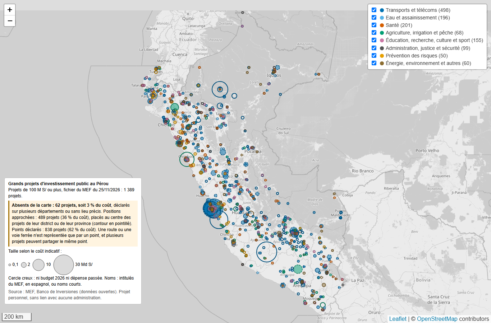

# Pipeline des grands projets d'investissement public au Pérou

Projet personnel de Stanislas Sassolas (élève-ingénieur, CPE Lyon), sans lien avec aucune administration.

[](https://stanislas-sassolas.github.io/pipeline-inversiones-peru/carte.html)

[Voir la page du projet, avec la carte interactive](https://stanislas-sassolas.github.io/pipeline-inversiones-peru/)

Le ministère de l'Économie et des Finances du Pérou (MEF) publie chaque jour, en données ouvertes, la liste de tous ses investissements publics actifs : le Banco de Inversiones (environ 150 000 investissements, un CSV de 250 Mo). Ce pipeline de données en Python archive les versions successives du fichier, calcule des indicateurs sur les grands projets (100 millions de soles ou plus), repère ce qui change d'une semaine à l'autre, suit les consultations de ProInversión, et produit une fiche de deux pages et une carte interactive. Au 25/11/2026 : 1 389 grands projets, 726 milliards de soles de coût indicatif. Python, pandas, folium, 129 tests automatiques.

## En bref

| Sortie | Fichier | Script |
|---|---|---|
| Archive datée du fichier du MEF | `<données>/snapshots/inversiones_<date>.parquet` | `archiver.py` |
| Indicateurs (fichier de travail) | `exports/indicateurs_<date>.xlsx` | `indicateurs.py` |
| Ce qui a bougé (fichier de travail) | `exports/changements_<date1>_<date2>.xlsx` | `changements.py` |
| Consultations de ProInversión (fichier de travail) | `exports/proinversion_<date>.xlsx` | `proinversion.py` |
| Note de trois pages (lecture rapide) | `exports/note_<date>.pdf` | `note.py` |
| Fiche de deux pages (tous les indicateurs) | `exports/fiche_<date>.pdf` | `fiche.py` |
| Carte interactive | `exports/carte_<date>.html` | `carte.py` |
| Page de démonstration | `docs/` (GitHub Pages) | `pipeline.py --publier` |

Les fichiers « de travail » détaillent projet par projet. La fiche et la carte ne citent aucune entreprise en dehors des intitulés officiels du MEF, et ne classent aucune région.

Les règles de calcul et les limites de chaque étape sont détaillées dans [METHODE.md](METHODE.md).

## Installation et lancement

Python 3.11 et Google Chrome, puis :

```
python -m pip install -r requirements.txt
python -m pytest                               # les tests, sans Internet ni données : petits tableaux inventés
python pipeline.py                             # toutes les étapes, dans l'ordre
python pipeline.py --sans-archivage            # sans télécharger le fichier du MEF
python pipeline.py --sans-archivage --publier  # puis mise à jour de docs/
```

Le pipeline a besoin d'au moins deux archives de jours différents : le premier jour, lancer seulement `python archiver.py`, puis `python pipeline.py` le lendemain. Il a aussi besoin d'Internet : le MEF (archivage, environ 250 Mo), la BCRP (taux de change, gardé ensuite en cache), investinperu.pe (une fois par jour) et, pour la capture de la carte, Leaflet et les tuiles OpenStreetMap. Chrome est trouvé tout seul sous Windows et Linux ; sinon, indiquer son chemin dans la variable d'environnement `CHROME`. Les archives sont rangées hors du dépôt, dans `~/data/inversiones-peru` (variable `INVERSIONES_DATA`).

Les tests tournent aussi automatiquement sur GitHub à chaque envoi (`.github/workflows/tests.yml`).

Fichiers faits à la main, avec leur source quand c'est une correction : `secteurs.csv` (regroupement des fonctions en secteurs), `corrections_projets.csv` (corrections et notes par projet), `correspondance_proinversion.csv` (lien entre consultations et projets du MEF), `fiche/lecture.txt` (texte « À retenir » de la note, 900 caractères au plus, à créer : tant qu'il manque, la note reste un brouillon et n'est pas publiée), `fiche/noms_courts.csv` et `fiche/noms_consultations.csv` (noms courts). Le dictionnaire des colonnes du fichier du MEF est dans `dictionnaire_colonnes.md`.

## Sources

- MEF, Banco de Inversiones, données ouvertes : https://fs.datosabiertos.mef.gob.pe/datastorefiles/DETALLE_INVERSIONES.csv
- BCRP, série PN01207PM (taux de change) : https://estadisticas.bcrp.gob.pe
- ProInversión : https://www.investinperu.pe
- Fond de carte : © contributeurs OpenStreetMap

Les montants sont des coûts totaux pluriannuels indicatifs, en soles. Le fichier ne contient que les investissements publics qui ont un code (CUI) : les projets miniers privés n'y figurent pas, ni les partenariats public-privé encore trop peu avancés pour avoir un code.

## Pistes

- Relier les projets aux marchés publics (données OCDS) pour suivre la passation des études et des travaux.
- Fiches sectorielles (eau, rail, hôpitaux) sur le même modèle.
- Ajouter le portefeuille de projets de ProInversión (APP et actifs), si une source publique documentée devient disponible.

## Licence

Code sous licence MIT (fichier `LICENSE`). Les données restent celles de leurs producteurs : MEF (Banco de Inversiones, données ouvertes), BCRP, ProInversión ; fond de carte © contributeurs OpenStreetMap.
